# SGMF — Sistema de Gestión de Mantenimiento de Flota (AeroAgro Drones)

Proyecto de arquitectura de software: modelado de un sistema que apoya el **mantenimiento preventivo** de una flota de drones de fumigación agrícola de **AeroAgro Drones S.A.S.**. El sistema registra horas de vuelo y ciclos, controla las condiciones de mantenimiento de cada componente, planea las intervenciones y genera indicadores, dentro de la normatividad aeronáutica.

El modelo se construye en **ArchiMate** (herramienta Archi) y se descompone con **Domain-Driven Design**: 9 contextos delimitados, mapa de contextos con patrones DDD y un Bounded Context Canvas por contexto núcleo.

## Enlaces rápidos

- 📄 [Entrevista al experto del negocio](entrevista/entrevista.md) — fuente de todos los requisitos.
- 🧩 Modelo ArchiMate: [`modelo/modeloterminado.archimate`](modelo/modeloterminado.archimate)
- 🧠 Argumentación de las decisiones: [análisis de vistas V1–V6](vistas/analisis_de_vistas_V1-V6.md) y [análisis de vistas V7–V11](vistas/analisis_de_vistas_V7-V11.md)

## Estructura del repositorio

```
entrevista/   Entrevista al experto del negocio
modelo/       Modelo ArchiMate (.archimate)
vistas/       Vistas exportadas a PNG y análisis de cada vista (V1–V11)
```

## Vistas del modelo

### V1 — Motivación

Por qué existe el SGMF: interesados, problemas, metas con cifras, resultados, requisitos, principios y restricciones.

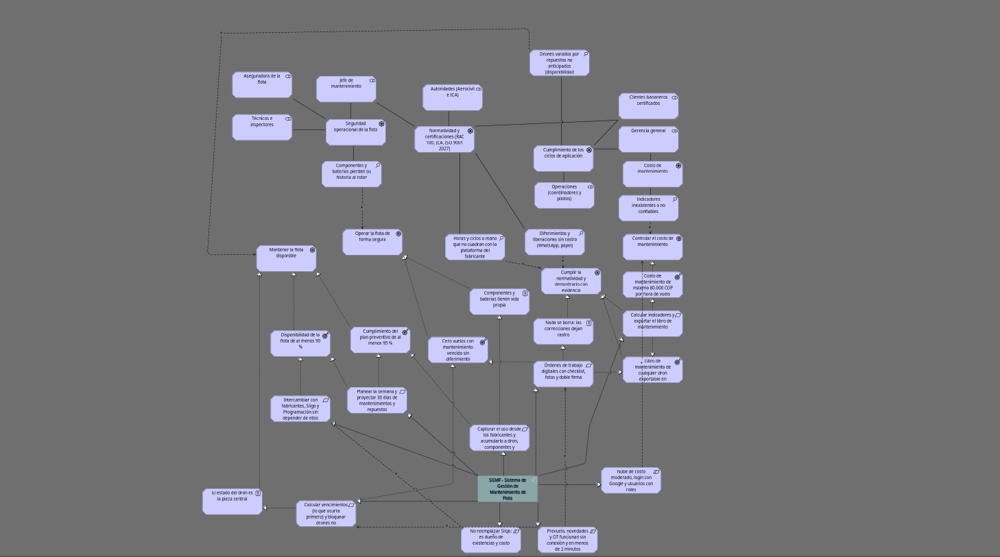

Argumentación: [análisis V1–V6, sección V1](vistas/analisis_de_vistas_V1-V6.md#v1--motivación-archimate-de-motivación)

### V2 — Mapa de capacidades

Capacidades de la empresa y cuáles impacta el sistema (directo o indirecto), con los cursos de acción que conectan con las metas de V1.

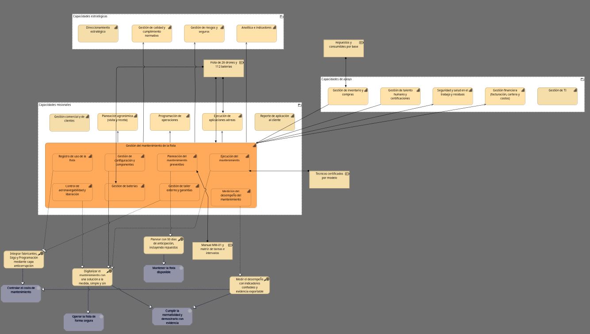

Argumentación: [análisis V1–V6, sección V2](vistas/analisis_de_vistas_V1-V6.md#v2--mapa-de-capacidades-archimate-de-estrategia)

### V3 — Cadena de valor y proceso E2E

Etapas de valor vistas por el cliente, el proceso de extremo a extremo en 10 pasos y los actores que los ejecutan. El mantenimiento aparece como proceso paralelo que consume horas y ciclos.

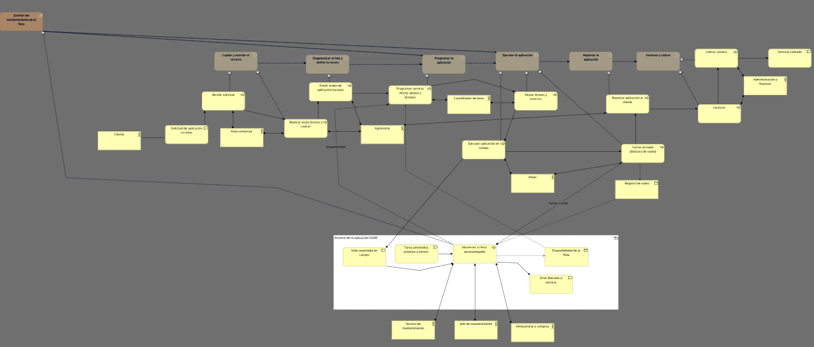

Argumentación: [análisis V1–V6, sección V3](vistas/analisis_de_vistas_V1-V6.md#v3--cadena-de-valor-y-proceso-e2e-archimate-de-negocio)

### V4 — Descomposición de servicios

Siete capas de servicio, qué entra y qué queda fuera del alcance, quién es responsable de cada servicio y los contratos de los 10 servicios más importantes.

| Subvista | Imagen |
|---|---|
| V4a — Siete capas e inclusión/exclusión | 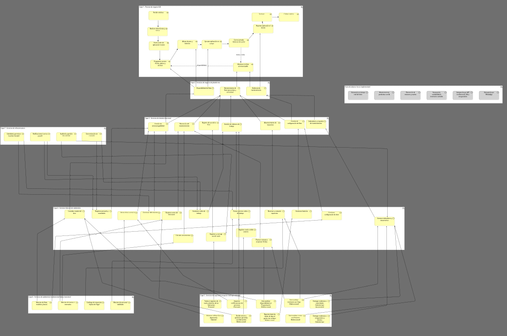 |
| V4b — Responsables | 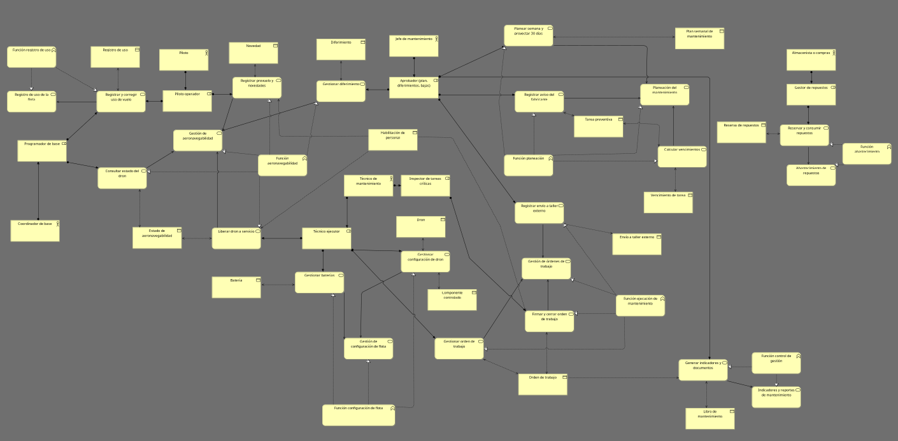 |
| V4c — Contratos | 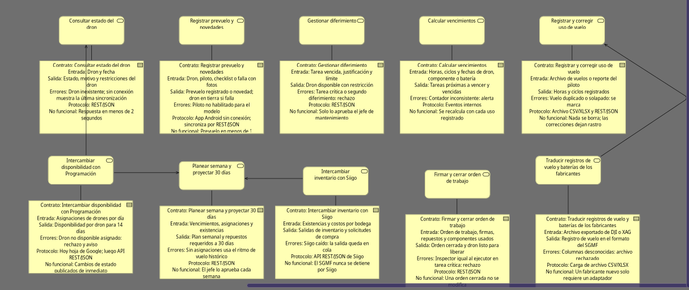 |

Argumentación: [análisis V1–V6, sección V4](vistas/analisis_de_vistas_V1-V6.md#v4--descomposición-de-servicios-archimate-de-negocio)

### V5 — Dominios

Nueve dominios clasificados en núcleo, soporte y genérico, cada uno como candidato a contexto delimitado, con el ecosistema externo.

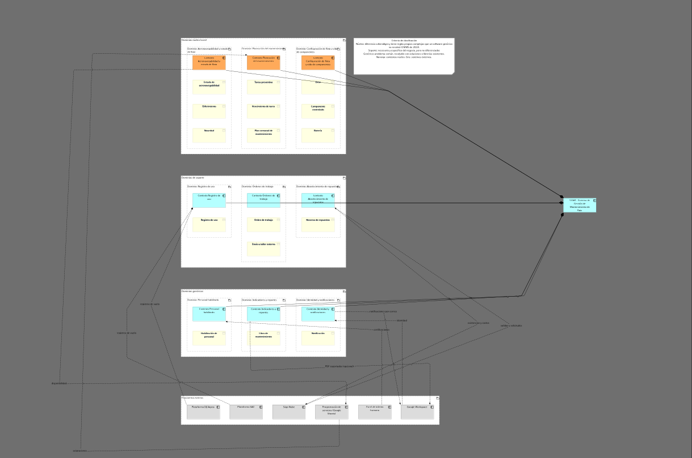

Argumentación: [análisis V1–V6, sección V5](vistas/analisis_de_vistas_V1-V6.md#v5--dominios-archimate-de-aplicaciones)

### V6 — Agregados, comandos y eventos

Por dentro de cada dominio: raíz y partes, comandos, eventos e invariantes. Se dividió en tres diagramas según la clasificación del dominio.

| Subvista | Imagen |
|---|---|
| V6.1 — Dominios núcleo | 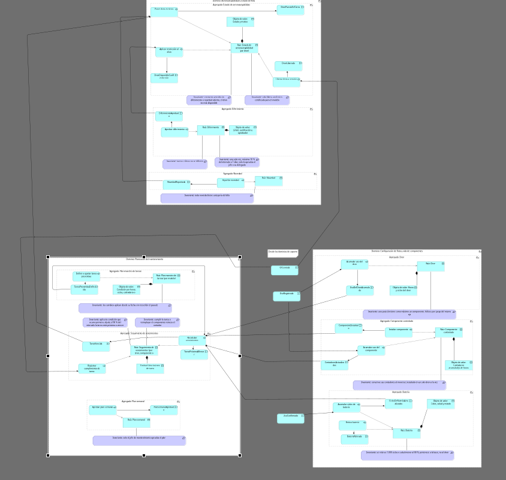 |
| V6.2 — Dominios de soporte | 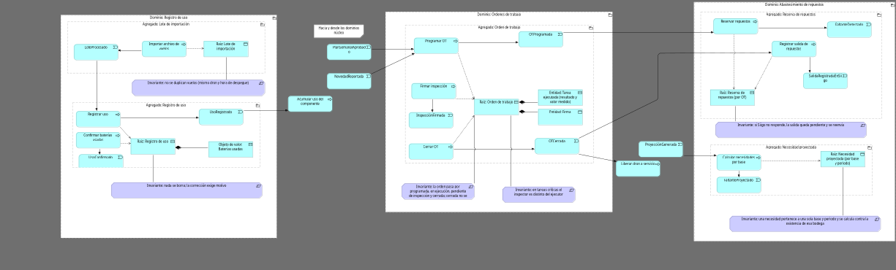 |
| V6.3 — Dominios genéricos | 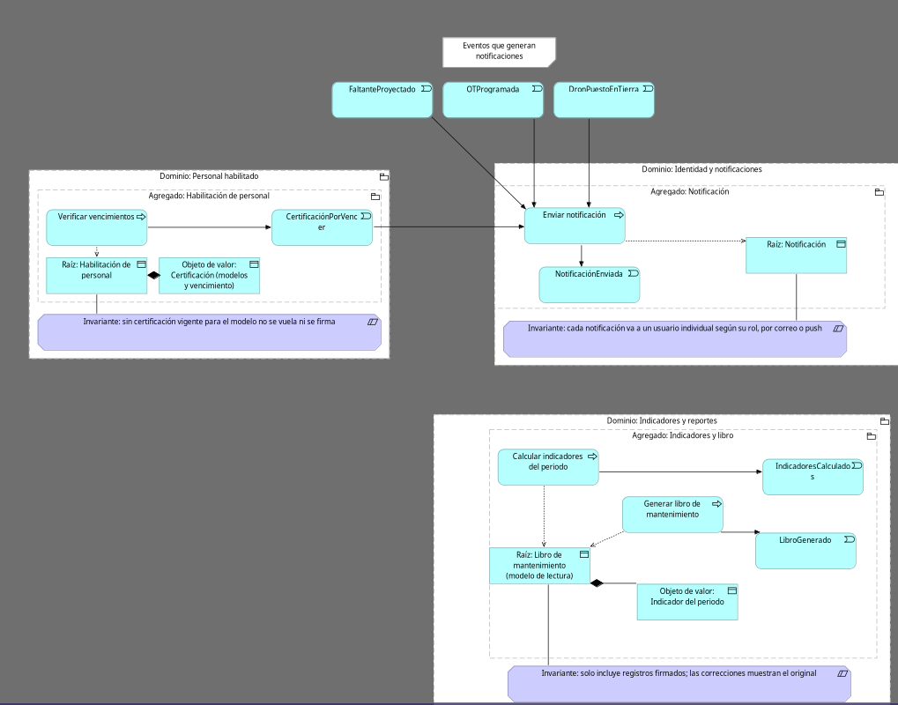 |

Argumentación: [análisis V1–V6, sección V6](vistas/analisis_de_vistas_V1-V6.md#v6--agregados-comandos-y-eventos-archimate-de-aplicaciones)

### V7 — Lenguaje ubicuo

Términos del negocio, su significado en cada contexto y dónde se registra hoy cada dato. Incluye los homónimos entre contextos.

| Subvista | Imagen |
|---|---|
| V7.1 — Términos clave | 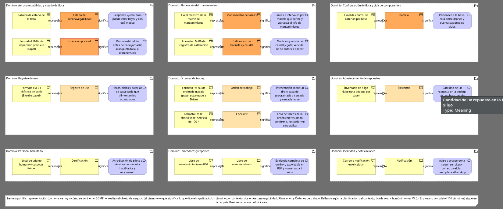 |
| V7.2 — Homónimos | 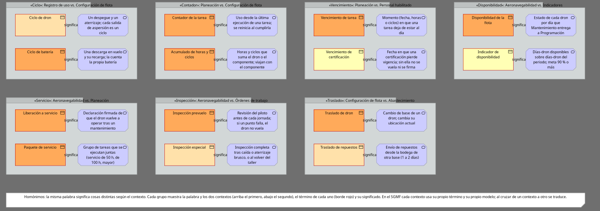 |

Argumentación: [análisis V7–V11, sección V7](vistas/analisis_de_vistas_V7-V11.md#v7--lenguaje-ubicuo-archimate-de-negocio)

### V8 — Mapa de contextos

Relaciones entre los 9 contextos y con los sistemas externos, con el patrón DDD de cada relación (socios, cliente–proveedor, conformista, servicio abierto o capa anticorrupción).

| Subvista | Imagen |
|---|---|
| V8.1 — Contextos y patrones | 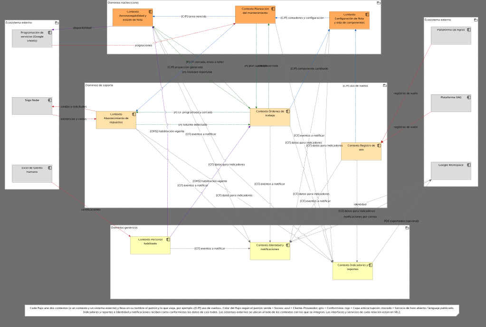 |
| V8.2 — Interfaces y servicios | 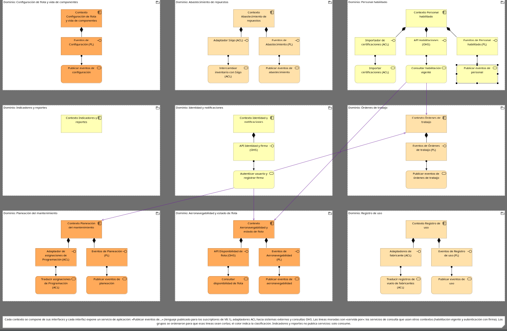 |

Argumentación: [análisis V7–V11, sección V8](vistas/analisis_de_vistas_V7-V11.md#v8--mapa-de-contextos-archimate-de-aplicaciones)

### V9 — Interoperabilidad y anticorrupción

Cómo se integra el SGMF con lo que está fuera de él: 18 integraciones con 15 contrapartes, cada una con su interfaz, servicio y patrón.

| Subvista | Imagen |
|---|---|
| V9.1 — Sistemas externos | 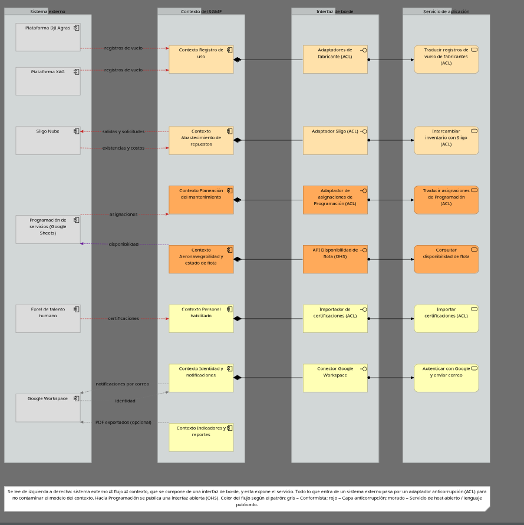 |
| V9.2 — Áreas internas y entidades sin API | 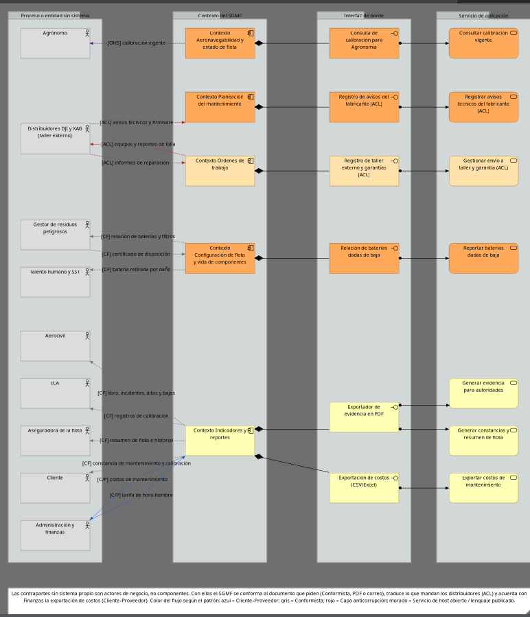 |

Argumentación: [análisis V7–V11, sección V9](vistas/analisis_de_vistas_V7-V11.md#v9--interoperabilidad-y-anticorrupción-archimate-de-aplicaciones)

### V10 — Trazabilidad vertical

Cadena completa desde las metas del negocio hasta los contextos del software, por dos caminos: motivación y estrategia.

| Subvista | Imagen |
|---|---|
| V10.1 — Camino de motivación | 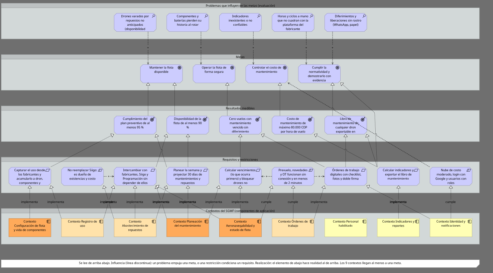 |
| V10.2 — Camino de estrategia | 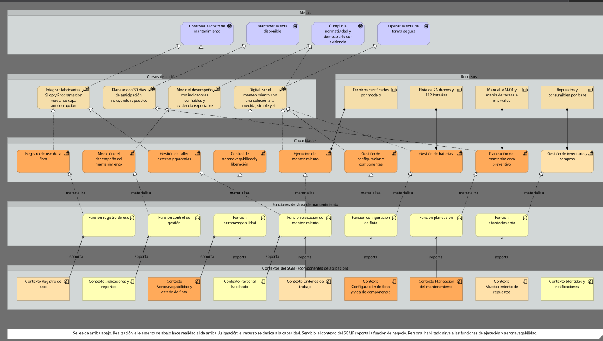 |

Argumentación: [análisis V7–V11, sección V10](vistas/analisis_de_vistas_V7-V11.md#v10--trazabilidad-vertical)

### V11 — Bounded Context Canvas

Resumen en una página de los contextos núcleo, con el formato del Bounded Context Canvas de DDD Crew.

| Subvista | Imagen |
|---|---|
| V11.1 — Aeronavegabilidad | 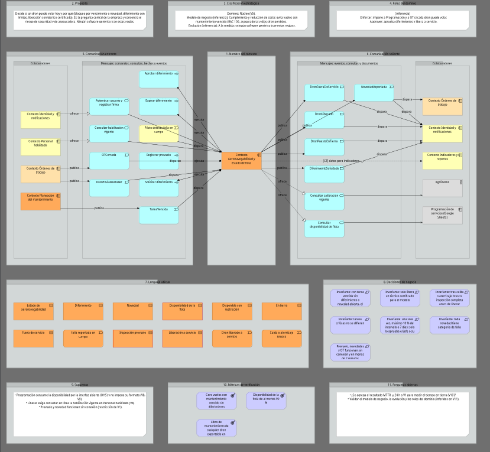 |
| V11.2 — Planeación | 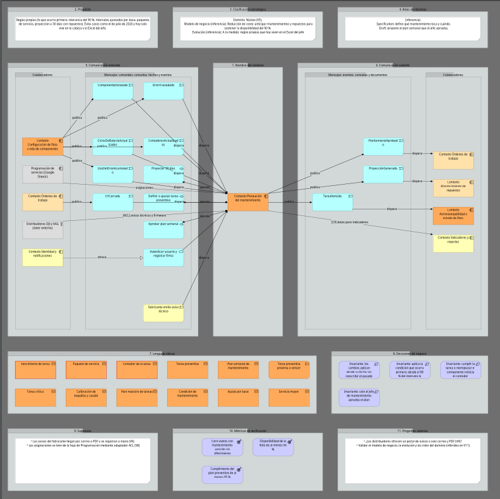 |

Argumentación: [análisis V7–V11, sección V11](vistas/analisis_de_vistas_V7-V11.md#v11--bounded-context-canvas-archimate-canvas)

## Aportes por integrante

Cada fila se puede verificar con el hash del commit en el historial de `main`.

| Integrante | Commit | Qué construyó | Verificación |
|---|---|---|---|
| **carlosandresfv2007** | `9ca8918` "v1 model" | Primera versión del modelo ArchiMate (`modelo/modelovv1.archimate`, reemplazado después) y los archivos base de `entrevista/` y `modelo/`. | `git show --stat 9ca8918` |
| **Josemj-07** | `3d4091c` "commit inicial" | Estructura inicial del repositorio (README y carpetas con archivos base). | `git show --stat 3d4091c` |
| Josemj-07 | `b6a6dd0` "agrega el documento de la entrevista en su primera version" | Documento de la entrevista al experto (`entrevista/entrevista.md`): contexto, guion y respuestas. | `git show --stat b6a6dd0` |
| Josemj-07 | `ce2746b` "agrega el analisis y modelo.archi de las vistas 7-11" | Modelo `modelo/modelo.archimate` que reemplazó la versión 1, primer análisis de las vistas 7–11 y ajustes en la entrevista. | `git show --stat ce2746b` |
| Josemj-07 | `4914221` "mejora las vistas reduciendo la carga visual y actualiza la documentacion" | Reducción de la carga visual del modelo y actualización del análisis de V7–V11. | `git show --stat 4914221` |
| Josemj-07 | `4543bc2` "mejor la distribucion visual de algunos diagramas" | Ajuste de la distribución visual de diagramas del modelo. | `git show --stat 4543bc2` |
| Josemj-07 | `1d440fa` "agrega vistas exportadas a imagen en formato .png" | Exportación a PNG de las vistas V7–V11 (10 imágenes). | `git show --stat 1d440fa` |
| *Pendiente* | Sin commit | Vistas V1–V6 (PNG), `vistas/analisis_de_vistas_V1-V6.md` y el renombrado a `modelo/modeloterminado.archimate`. Están preparados pero **aún no están commiteados**, por lo que su autoría no es verificable en el historial. | `git status` |

Para ver el aporte de cada integrante:

```bash
git log --author="carlosandresfv2007" --stat
git log --author="Josemj-07" --stat
```
